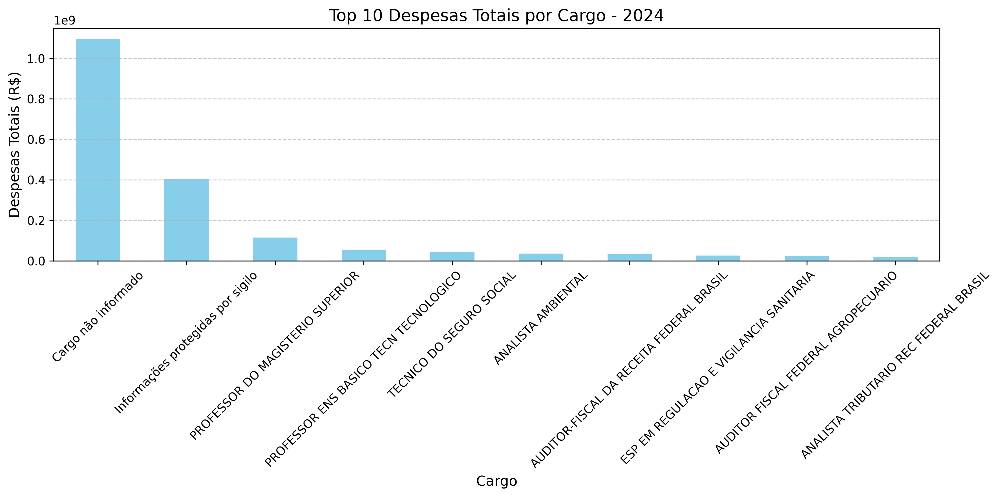
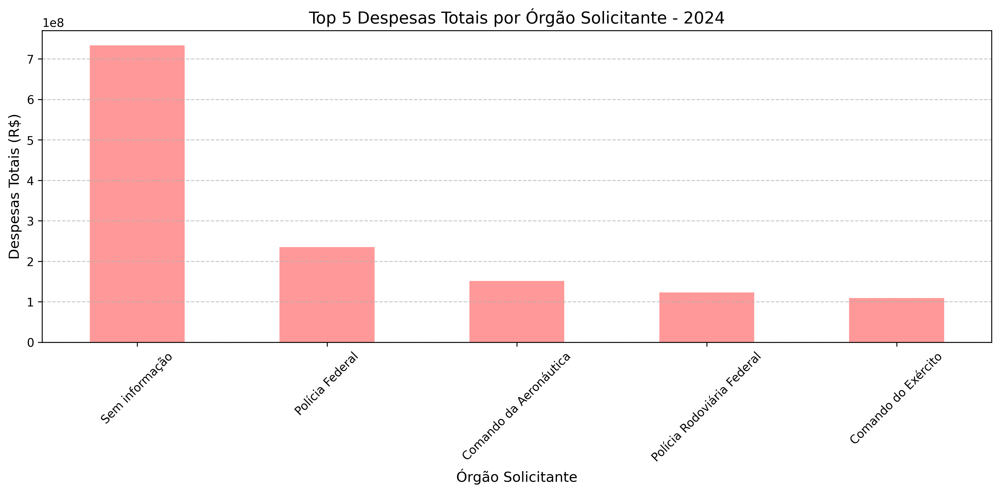
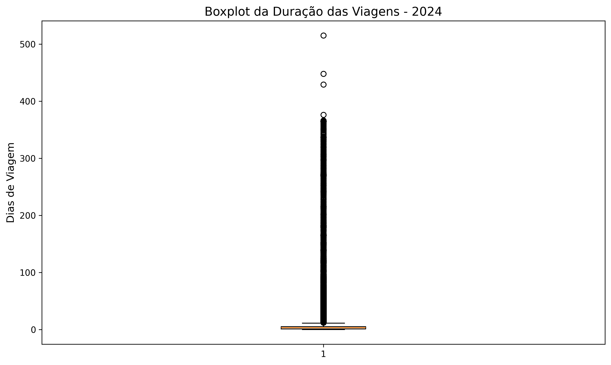

# Análise de viagens a serviço: Portal da Transparência 2024

Análise exploratória das viagens oficiais do Governo Federal registradas em 2024: quais cargos e órgãos gastam mais, para onde se viaja, quanto duram as viagens e onde os dados têm problema.

Stack: Python, pandas, Matplotlib e Jupyter.
Fonte: [Portal da Transparência do Governo Federal](https://portaldatransparencia.gov.br/) (CGU), seção Viagens a Serviço.

## Principais resultados

- Despesa total das viagens em 2024: [PREENCHER: R$ X, soma de diárias, passagens e outros gastos].
- "Cargo não informado" é o maior grupo de despesa, com [PREENCHER: X% do total]. Isso aponta falha de preenchimento no cadastro.
- Brasília/DF é o destino mais frequente. O Rio de Janeiro/RJ também aparece entre os mais frequentes. Destinos internacionais, como Xangai, têm as passagens mais caras.
- Viagens urgentes tendem a custar mais: [PREENCHER: R$ X de despesa média contra R$ Y nas não urgentes].
- Uma viagem de 365 dias em janeiro (linha 9918) distorce a duração média. Possível erro na data final (2024-12-31). A média geral exclui esse caso.
- Os órgãos com maior despesa incluem o Ministério da Agricultura e Pecuária e a Polícia Federal: [PREENCHER: valores].







O relatório completo, com as 7 análises e as conclusões, está em [relatorio.md](relatorio.md).

## Origem do projeto

A primeira parte segue o curso Python para Dados: do Zero à Análise Completa, da Asimov. As análises, os achados e as conclusões são meus.

## Como rodar

Você precisa de Python 3.10 ou superior e Git.

1. Baixe os dados no Portal da Transparência, seção Viagens a Serviço. Os arquivos são grandes e ficam fora do repositório: `2024_Viagem.csv`, `2024_Pagamento.csv`, `2024_Passagem.csv` e `2024_Trecho.csv`. Coloque-os em [PREENCHER: pasta que o notebook espera].
2. Crie o ambiente virtual e instale as dependências:

```bash
python -m venv .venv

# Windows
.venv\Scripts\activate

# Linux ou Mac
source .venv/bin/activate

pip install -r requirements.txt
```

3. Abra os notebooks no Jupyter ou no VS Code e rode as células em ordem.

## Estrutura

```
images/                       gráficos usados no relatório
output/                       saídas geradas pelos notebooks
analise.ipynb                 [PREENCHER: o que este notebook cobre]
analise_viagens_2024.ipynb    [PREENCHER: o que este notebook cobre]
relatorio.md                  relatório com análises e conclusões
requirements.txt              dependências
```
